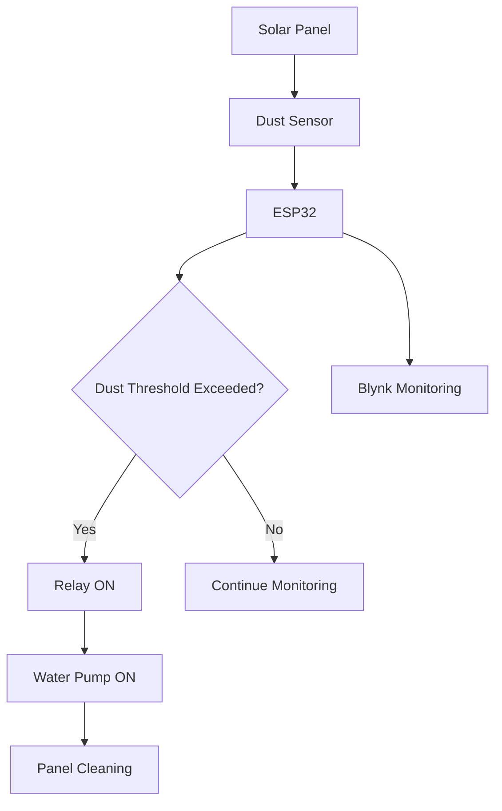

# ☀️ IoT-Based Automatic Solar Panel Cleaning System

<div align="center">


**An IoT-based system designed to automate solar panel cleaning by monitoring dust accumulation and controlling a water pump.**

</div>

---

## 📌 Project Overview

Dust accumulation on solar panels can reduce their ability to absorb sunlight and generate electricity. Regular manual cleaning requires time and effort.

This project aims to develop an **IoT-based automatic solar panel cleaning system** that monitors dust levels using a dust sensor and activates a water pump when dust exceeds a predefined threshold.

An ESP32 microcontroller manages the cleaning process, while the Blynk platform provides remote monitoring.

## 🎯 Objectives

- Monitor dust accumulation on solar panels.
- Automate the cleaning process using a water pump.
- Reduce manual cleaning effort.
- Monitor system status remotely using Blynk.
- Explore IoT-based automation for renewable energy applications.

## ⚙️ Components Required

| Component | Purpose |
|---|---|
| ESP32 | Main microcontroller |
| Dust Sensor | Detects dust accumulation |
| Relay Module | Controls the water pump |
| Water Pump | Supplies water for cleaning |
| Blynk Platform | Remote monitoring |
| Power Supply | Provides power to the system |
| Connecting Wires | Circuit connections |

## 🔄 Working Principle

1. The dust sensor monitors dust accumulation on the solar panel.
2. The sensor sends readings to the ESP32.
3. The ESP32 compares the readings against a predefined threshold.
4. If the threshold is exceeded, the ESP32 activates the relay.
5. The relay switches on the water pump.
6. The system provides monitoring information through Blynk.

## 🧠 System Architecture



## 🛠️ Technologies Used

- ESP32
- Embedded C / Arduino IDE
- IoT
- Blynk IoT Platform
- Dust Sensor
- Relay-Based Automation

## 📂 Project Structure

```text
iot-based-solar-panel-cleaning-system/
│
├── README.md
├── code/
├── circuit/
├── images/
└── docs/
```

*Project files and implementation details will be added as development progresses.*

## 🚀 Expected Outcomes

- Automatic detection of dust accumulation.
- Automatic activation of the cleaning mechanism.
- Remote monitoring of system status.
- Reduced dependence on manual cleaning.

## 🔮 Future Improvements

- Add real-time solar power output monitoring.
- Introduce water usage optimization.
- Explore automatic scheduling.
- Add weather-based cleaning decisions.
- Improve cleaning efficiency using intelligent control.

## 👩‍💻 Author

**Sakshi**

B.Tech – Information Science Engineering  
RV College of Engineering, Bengaluru

[GitHub](https://github.com/Sakshi8017) | [LinkedIn](https://www.linkedin.com/in/sakshi67/)

---

⭐ If you find this project interesting, feel free to explore the repository!
